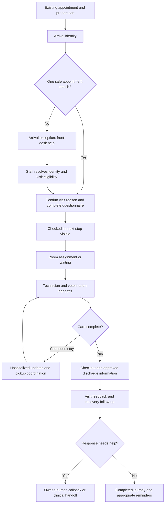
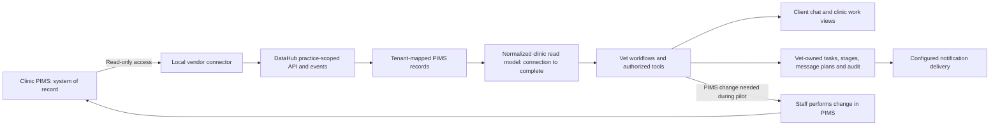

# V1 - Vet product direction

Prepared September 13, 2026 from five supplied documents and a targeted inspection of the working tree, including the subsequently consolidated mainline.
Status: discussion brief. Proposed choices below need discussion before they become a PRD or change the existing product contract.

Current user direction: preserve the requests, prepare a quick understanding and email draft, and investigate free review collection. Product implementation and detailed planning are deferred until integration approval and the user's availability. See the [conversation brief](conversation-brief.v1.md).

Latest supplied evidence, September 13: DataHub reports the remaining setup items are confirmed and asks for an explicit go-ahead to activate read-only sync. The [screenshot and reply draft](.local/datahub-sync-confirmation.v1.md) are saved locally. Activation and successful live sync are not yet confirmed. The user's intended sequence is to let the integration run for about a week, inspect the actual data, and then decide the next build scope.

## Recommended direction

Build a hospital-branded, multi-tenant operations product that helps clients and clinic teams complete the whole visit with less confusion and fewer missed handoffs. During the integration phase, keep Cornerstone as the system of record because it holds the clinic's existing data. Use agents to understand requests, retrieve authorized information, and invoke reliable workflow actions.

The user has clarified the longer-term direction: move away from Cornerstone into this product. Integration is the first stage, not a permanent requirement to remain a companion product. The eventual replacement scope and migration/cutover criteria have not been agreed; no migration or replacement implementation is authorized by this brief.

The next milestone should be one complete, observable workflow at the design-partner hospital: **read a real appointment, match its arrival, show the team what happens next, record visit progress, and complete an appropriate follow-up or human handoff.** Start with read-only PIMS integration and staff-owned PIMS changes. Agree messaging policy before enabling customer delivery.

The largest observed technical gap is between receiving PIMS data and actually using it in the product. The repository already ingests DataHub records, but the inspected agent, arrival, account-claim, and portal paths still read mock clinic tables. A successful webhook alone does not complete that connection. See the evidence table below.

This recommendation prioritizes the customer outcome described throughout the notes. A broad clinical copilot, automated pricing, payments, and autonomous booking remain possible later stages with distinct requirements.

## Source documents

| Source | Substance preserved | How to interpret it |
| --- | --- | --- |
| [Client requests](client-requests.v1.md), shared ChatGPT conversation beginning August 30, plus later user-relayed additions | All four visible client prompts, email-assistance/result-interpretation requests, and OpenVet/Eight Sleep references, verbatim with separate provenance | Earlier AI responses are omitted. No review corpus was included. Later additions are the user's account of desired capabilities. |
| [Project goals](project-goals.v1.md), undated product and workflow notes | Full supplied wording, verbatim | Desired outcomes and unresolved alternatives. The notes distinguish gathering data from booking appointments. |
| [Agentic startup](agentic-startup.v1.md), undated agent-design notes | Full supplied wording, verbatim | Model choices, search weights, fees, autonomy, and infrastructure remain proposals to discuss. |
| [DataHub](datahub.md#pilot-decisions-from-supplied-correspondence), July 29 to September 8 correspondence | Main agreements, vendor statements, and remaining questions | Dated correspondence, not verification of installed configuration or production operation. |
| [Agent-rules reference](reference-agent-rules.v1.md) | Full supplied example, verbatim | A reference document, not wholesale replacement of the repository's scoped instructions. |

The source records preserve original wording, including transcription errors. This document is assistant-authored analysis, separate from those records. Only explicit user decisions enter [verbatim ADRs](adr/0002-preserve-original-requests.v1.md); recommendations here are not accepted decisions.

OpenVet's current official site describes clinical decision support using patient history and cited veterinary evidence, alongside a PIMS that handles scheduling, billing, and other operations. Its OpenAnimal practice connection is described as still being developed. These vendor descriptions help explain the client's reference; they do not establish that Vet needs the same clinical scope or that either product has a proven Cornerstone connection. Sources checked September 13: [OpenVet](https://www.openvet.ai/) and [OpenAnimal practice connection](https://www.openvet.ai/openanimal).

Missing source attachments: the DPA, countersigned services agreement, security/installation attachments, designer reference, actual customer reviews, and production-sync evidence. The existing [DataHub runbook](datahub.md) captures an earlier API/schema review and sandbox proof; its presence does not verify current production operation.

## Product principles

1. **Work backward from clients and clinic teams.** Measure completion, clarity, saved effort, and timely care handoffs. Agent count is not a success metric.
2. **One common product, configured by hospital.** Branding, domains, senders, hours, forms, rooms, messaging, and PIMS provider belong to the tenant. Central Veterinary Hospital and Tri-City Veterinary Hospital remain distinct.
3. **Chat is a convenient entrance.** Provide suggested actions, concise status, and structured controls where those are easier than typing. Keep the staff task board and visit overview available at a glance.
4. **Show the next useful step.** Clients need their current stage and next action; staff need work ownership and exceptions; veterinarians need relevant clinical handoffs; Admin needs clinic controls and performance.
5. **Retain a human path.** A receptionist can help someone without a phone, account, matched appointment, or desire to use a form. Customer account creation is optional for arrival.
6. **Make action status honest.** Distinguish requested, awaiting staff, completed in Vet, and confirmed in the PIMS. Show unavailable or stale data explicitly.
7. **Make clinical responsibility clear.** Client-facing agents collect concerns and route them to the team. Clinical advice, record approval, and care decisions require a separate clinician-led scope.
8. **Make automation inspectable.** Record who requested an action, its scope, approval where applicable, and actual result. Keep private clinic and customer data within authorized boundaries.

These principles use the vocabulary in [CONTEXT.md](../CONTEXT.md). Technician and virtual-assistant responsibilities need operational clarification; the notes do not establish a complete permission model for either.

## The visit we should support

This is a proposed product flow, not an exact mirror of the current database state machine. A pre-arrival questionnaire must not imply that the client is physically present. Keep preparation separate from the recorded arrival event.

| Stage | Client experience | Team responsibility and exceptions |
| --- | --- | --- |
| Before arrival | Hospital-branded instructions and consented reminders; easy access to appointment details | Use actual appointment data. Appointment requests remain requests until staff or an authorized adapter confirms them. |
| Identity | Ask for the account owner's clinic contact; prefill appropriately and allow correction | Match one client, patient, and current appointment. Do not reveal unrelated records from a shared phone number. Route walk-ins, ambiguity, and unmatched clients to staff. |
| Questionnaire | Short questions relevant to the confirmed visit reason | Preserve the existing clinic-editable questionnaire. Collect symptoms without inventing medical conclusions. Decide with clinicians which branching questions are necessary. |
| Arrival and room | Clear confirmation and the next step | Configure room assignment; allow staff overrides; include occupied, cleaning, closed, and open states. A room must not become available merely because payment occurred. |
| Care | Simple progress such as waiting, team with your pet, or ready for checkout | Observe technician, weighing, veterinarian, treatment, and hospitalization handoffs before deciding which stages need separate controls. Assign ownership to waiting work. |
| Checkout | Clear approved service information, payment instructions, discharge access | During the read-only pilot, existing clinic processes own payment and PIMS checkout. Vet records the operational stage with its source. Later online payments require reconciliation. |
| Follow-up | An appropriate pet-health check and a way to request help | Route negative experiences to service recovery and health concerns to the clinical team. A no-response call queue follows clinic timing; urgent concerns must not wait for that queue. |

Task management accompanies every stage: owner, priority, status, relevant context, and a clear completion condition. Alerts should identify work requiring attention and avoid repeatedly notifying everyone about the same event. Browser and SMS alerts are channels to evaluate, not proof that delivery already works.

## Five candidate pain points to validate

The original conversation supplied no reviews. The user has since supplied Yelp and Google scraper exports, now stored locally for analysis. These are still **candidate themes inferred from the workflow notes**, not ranked review findings; theme analysis of the exports has not yet run.

| Candidate pain point | Product response | Evidence to collect |
| --- | --- | --- |
| Difficulty reaching the clinic or knowing whether a request was handled | Request capture, ownership, acknowledgment, and human handoff | Review examples; first-response and resolution times; abandoned requests |
| Repeated questions and confusing check-in | Match first, prefill carefully, concise questionnaire, staff-assisted arrival | Observed arrival steps, completion time, errors, and staff corrections |
| Waiting without an explanation | Current visit stage, next step, and team handoffs | Median and 90th-percentile wait by stage; status-related calls |
| Confusing checkout, costs, or discharge instructions | Approved itemization, clear checkout status, accessible discharge information | Review themes, checkout time, billing clarification requests |
| Weak follow-up or unresolved concerns | Recovery follow-up, assigned callback, and confirmed resolution | Eligible follow-ups completed, callbacks overdue, and response outcomes |

Next research should cover the correctly identified hospital's available reviews across a stated date range, remove duplicates, retain complaint examples and counts, and distinguish operational issues from clinical allegations requiring professional review. Do not combine different hospitals' reviews or claim that an incomplete collection represents all reviews.

### Requested review collection: Google and Yelp

The user requests all customer reviews from both platforms, preferably with no paid service, including unofficial methods, to understand what customers value and the problems the product should address. Research and a direct public-page collection test ran September 13, 2026. The user subsequently supplied scraper exports, which were moved unchanged into the ignored [local review folder](.local/review-research/README.md).

Current inputs: 400 Yelp rows with 362 unique review IDs, and 565 unique Google reviews for the correct clinic. Yelp contains 38 repeated IDs with matching text/rating/date. The exports' listing totals are 383 for Yelp and 560 for Google, so complete coverage is not verified. Dates span 2013-2026; 104 Google entries contain ratings without text. Use these exports for the next analysis, retaining the earlier 54-card website sample only as a separate historical source.

| Route | What is verified | Suitability |
| --- | --- | --- |
| Google Business Profile API | Google states there is no API usage charge. The reviews endpoint lists reviews for a verified location, up to 50 per page, with pagination and a total count. Owner/manager authorization and approved API access are required. | A verified no-service-fee route to all reviews the API exposes for the clinic. Access is separate from Cornerstone/DataHub approval. |
| Yelp standard Places API | Returns up to three review excerpts. | Does not satisfy the full-review requirement. |
| Yelp Private Reviews API | Requires a contracted partnership; coverage depends on the agreement. Yelp's Insights FAQ describes the latest 200 reviews and prohibits exporting reviews out of the partner dashboard. | Not a verified free full-history export route. Do not buy access assuming it solves this task. |
| Yelp account download | Describes the account's own information/contributions. A complete export of all customer reviews received by a business is not established. | Do not assume the clinic's account download contains every customer's review. |
| Public-page collection | A direct request retrieved 54 Google-labeled cards from the clinic's website. Direct Yelp access returned HTTP 403; its indexed first page was readable, but later pages and its separate non-recommended section were unavailable through the research tool. | Useful for establishing listing identity and a partial sample. Not a complete export of either platform. |

Sources: [Google pricing](https://developers.google.com/my-business/content/pricing), [review pagination](https://developers.google.com/my-business/reference/rest/v4/accounts.locations.reviews/list), [access prerequisites](https://developers.google.com/my-business/content/prereqs), [Yelp standard endpoint](https://docs.developer.yelp.com/docs/places-intro), [Yelp partner access](https://docs.developer.yelp.com/docs/private-reviews-api), [Yelp partner limits](https://docs.developer.yelp.com/docs/faqs), and [Yelp account downloads](https://www.yelp-support.com/article/How-can-I-access-my-Yelp-data?l=en_US).

**What the unofficial tools do:** open the business listing, sort/load reviews, expand text, scroll or paginate, and save structured records. Google collectors such as [gaspa93/googlemaps-scraper](https://github.com/gaspa93/googlemaps-scraper) expose a requested review count and sorting. The self-hosted [gosom/google-maps-scraper](https://github.com/gosom/google-maps-scraper) documents only roughly 300 reviews with its extra-reviews option, so it is not automatically an all-history solution. [yin/apify-yelp](https://github.com/yin/apify-yelp) documents local execution but requires proxy configuration by default; its cloud platform consumes account resources. These are reference approaches, not tools verified to export this clinic's full history for free. No third-party scraper or extension was installed or executed.

**Actual sample:** the [clinic's reviews page](https://www.tricityvets.com/reviews) yielded 54 unique widget cards dated June 28, 2014 to June 4, 2019: 49 five-star and five four-star entries; 23 texts are truncated. All are labeled Google. Widget IDs are not Google review IDs, and the links point to the business rather than individual reviews. Preserve this as a historical positive testimonial sample, not a representative customer corpus. Raw HTML, CSV, JSON, and collection limits are in ignored [local research](.local/review-research/README.md).

The earlier in-app browser connection failed before any page could be opened. The clinic's old Google review link returned HTTP 404 on a direct request. The readable [Yelp indexed page](https://www.yelp.com/biz/tricity-veterinary-hospital-fremont-9) showed 369 recommended and 41 non-recommended reviews in a February 2026 snapshot; those are not verified current totals. The supplied Yelp export is now available, but does not identify recommended/non-recommended coverage. A full analysis must account for coverage and updated reviews.

For this one-off job, use a clinic-provided export or the free authorized Google API if available. Otherwise, the simplest unofficial retry is ordinary browser collection once a working browser session is available, applying the same scrolling/pagination method and checking coverage. Do not start with paid proxies, a trial service, or a new review-ingestion feature. If the site limits access, record the missing coverage rather than treating a sample as all reviews.

The eventual research output should record platform, exact hospital listing, review ID/link, rating, date, review text, owner response, and collection time. Preserve raw material privately and publish a concise theme summary. Include positive themes worth retaining as well as complaints. Record source counts, unique counts, oldest/newest dates, and missing/filtered categories; do not label partial results as all reviews. Review text describes customer reports and must not be presented as independently established clinical facts.

## What exists and what still needs proof

This is a targeted source inspection. Branch consolidation brings the existing local work and current remote mainline together; it does not certify production readiness or replace end-to-end workflow proof.

| Area | Observed evidence | Implication for the next milestone |
| --- | --- | --- |
| Shared app and tenant model | [Architecture](architecture.md), [product vocabulary](../CONTEXT.md), and [README](../README.md) describe one Next.js app and tenant-scoped Postgres modules | Extend the current product; preserve separate hospital identities. Prove isolation in the pilot paths. |
| DataHub ingestion | [Webhook handling](../apps/internal/app/api/integrations/datahub/_datahubWebhook.ts) authenticates and parses receipts; [database ingestion](../packages/db/src/datahub.ts) maps practices and stores PIMS records | Reuse the ingestion foundation. Verify real data, ordering, deletion, replay, freshness, and mapping before relying on it. |
| Data used by agents | [Clinic-data loader](../apps/internal/app/api/agent/_clinicData.ts) calls [listMockClinic](../packages/db/src/mockClinicSnapshot.ts), which reads mock tables | Add and prove the normalized read path from live PIMS records. Do not present mock results as live answers. |
| Arrival and customer identity | [Arrival persistence](../packages/db/src/arrivalIntake.ts), [account claims](../packages/db/src/clientAccountClaims.ts), and [portal data](../packages/db/src/clientJourneyPortal.ts) contain mock-table reads | The real-data connection must cover identity and customer flows as well as the agent loader. |
| Journey, tasks, notifications, analytics | Current [architecture documentation](architecture.md) describes visit stages, room turnover, message plans, feedback, and Admin analytics | Validate the existing path before adding parallel implementations. Delivery depends on configuration and consent. |
| Agent structure | [Agent architecture](agent-architecture.md) and [ADK agent definitions](../packages/agents/src/adkAgents.ts) use two top-level identities and tool groups | The current architecture does not implement the notes' coordinator-plus-specialist hierarchy. Decide whether a measured limitation justifies changing it. |
| ADK execution | [ADK runtime](../packages/agents/src/adkRuntime.ts) executes ADK, then uses a deterministic workflow for the stable result and persisted effects | Live model execution alone does not prove that model decisions control production outcomes. Define and test execution ownership before connecting external writes. |
| Memory | [Memory storage/search](../packages/db/src/agentMemory.ts) implements tenant-scoped search and correction/deletion, including a 0.7 vector / 0.3 text-rank expression when an embedding is supplied | This uses Postgres text ranking, not demonstrated BM25. Retrieval quality and automatic conversational memory still need separate evidence. |
| Booking, prices, payment | Existing agent contracts describe mock booking and pricing reports; no complete production payment/booking flow was established in this inspection | Treat real booking, payment collection, and price writeback as future capabilities until independently demonstrated. |

The existing DataHub runbook supplies historical sandbox proof. It is not a production test result from this review. No production service was modified or contacted on the clinic's behalf for this brief.

## Recommended integration architecture

DataHub can be the first provider adapter if the remaining onboarding evidence is satisfactory. Keep provider identifiers, source timestamps, and hospital mappings explicit. Normalize clients, patients, appointments, and the minimal required reference data before expanding to records, invoices, or labs.

Vet owns its operational tasks, message attempts, room workflow, and audit. A local workflow change is not a PIMS writeback. Define how later source updates reconcile with a staff-entered stage and retain provenance rather than blindly replacing newer state.

For incomplete or stale synchronization, show the last known update and offer staff help. Never create an appointment from a stale local slot or substitute seeded data for unavailable live data. Do not place raw PIMS payloads into unrestricted agent prompts.

A browser-based companion is the proposed first delivery surface. Embedding a dashboard inside Cornerstone would require an actual supported extension mechanism and is not established by the supplied material. Keep AVImark compatibility at the normalized contract boundary; provider availability and capability still need verification.

## OpenVet and Eight Sleep as references

The user now explicitly wants to study and adopt useful OpenVet capabilities and research email-based service using Eight Sleep as a reference. Email should be a practical way to request help, supply information, and complete work. The exact clinical and operational feature set remains to be selected from real clinic needs.

Initial primary-source checks, September 13, 2026:

| Reference | What is supported by the source | Useful pattern for Vet |
| --- | --- | --- |
| [OpenVet email workflow](https://www.openvet.ai/resources/openvet-opens-to-every-licensed-veterinarian-free), July 2 announcement | OpenVet says members can email clinical questions or forward blood-test results, receive structured clinical responses, and open the app for sources and further work. The veterinarian remains the decision-maker. This is a vendor description, not independent validation. | Clinical email intake, correct patient context, sourced interpretation, clinician review, and continuity with the patient's record. |
| [Eight Sleep support](https://help.eightsleep.com/en_us/what-are-you-business-hours-S1X5mlfr4) and [service requests](https://help.eightsleep.com/en_us/how-do-i-process-a-return-or-exchange-HknxSH5Iv) | Eight Sleep documents email as a service channel and a way to initiate returns/cancellations, alongside chat and phone. It does not say that all replies or resolutions are automated. | Email as an entry point to a complete service workflow, with context, a responsible owner, status, and a verified outcome. |

Research should map each candidate workflow to: the triggering email, needed data, resulting action or reply, completion evidence, and human involvement. Cover routine questions and status, appointment and records requests, result interpretation, estimates/invoice explanations, follow-up, and service recovery. Prioritize after the integration has run for roughly a week and actual data coverage can be inspected, as the user requested. Do not interpret a broad research inventory as an immediate build commitment or a reason to abandon the existing app and task infrastructure.

Use the existing client/staff separation for a first assessment. Routine service automation and clinical decision support need different evidence and review paths. Preserve email-thread context, avoid repeated requests for information already supplied, and ensure a handoff creates work that a person owns. No vendor or framework purchase has been selected. The initial [local research note](.local/openvet-email-research.v1.md) records the evidence gaps for deeper research.

## Agent choices to discuss

The user has additionally requested an email-response assistant and diagnostic interpretation of results arriving by email. Their [exact wording and working interpretation](client-requests.v1.md#additional-requests-relayed-by-the-user---september-13-2026) are captured separately. An OpenClaw-style helper is a reference, not a settled framework choice. Proposed scope: draft routine replies from verified clinic facts; match clinical results to the correct patient and prepare interpretations for veterinarian review. Clinical-result interpretation needs its own validation before customer delivery. Mailbox integration and sending behavior remain to be defined.

| Proposal in the notes | Recommended decision and reason |
| --- | --- |
| Master agent with multiple workers | Preserve the goal of capable delegation. Begin with the existing external/internal identities and narrow typed tools. Introduce a specialist only when evaluation shows it improves a distinct complex task; do not add a router hop to every fixed workflow. |
| Plan-and-execute agents for email and booking | Use deterministic workflow steps for required fields, preview, authorization, retries, and completion. Let the model interpret intent and explain results. A known sequence does not require another model. |
| Cheapest possible routing model or strongest model everywhere | Benchmark representative tasks on the smallest viable model and escalate on measured failures. Track completion rate, wrong actions, latency, tool calls, and cost per successfully completed task. |
| Agent-managed caching | Cache only suitable read results or static responses with server-owned keys and expiry. Scope by tenant, actor permissions, and relevant record version. Never replay a cached action as a new action result. |
| Conversation memory with fixed hybrid-search weights | Retrieve structured current facts directly first. Store durable preferences with source, scope, and correction/deletion. Avoid turning transient emotions into permanent facts. Evaluate ranking rather than treating the proposed weights as proven. |
| Minimal guardrails for Admin | Apply role and tenant authorization to every tool. Hospital Admin is not unrestricted platform access. Use the same authorization for an action performed through chat or a button. |
| Automatic price changes | Start with sourced, dated comparisons and recommendations. Match comparable services and expose missing evidence. Any future write requires an explicit clinic policy, limits, audit, and supported PIMS capability. |
| Email campaigns and post-visit messages | Keep separate purposes, consent, audiences, and schedules. Review template, recipients/count, timing, and send behavior together. Scheduled automation follows a saved approved configuration; material changes require renewed review. |
| Kafka and independently scaled agent services | Use the current deployment and durable Postgres-backed work state first. Add an outbox or worker only where delivery/retry needs it. Introduce a broker or separate service after a demonstrated throughput, isolation, or reliability need. |

Google's [official agent guidance](https://github.com/google/adk-docs/blob/main/docs/agents/index.md) supports starting with an agent and tools and evolving when task behavior or context demands it. The repository's [pinned ADK provenance](../opensrc/google-adk/README.md) and [agent-as-tool example](../opensrc/google-adk/adk-js/dev/samples/agent_as_tool.ts) provide implementation references. Keep the repository's ADK v1.3 dependency hold; current online documentation may describe newer APIs.

For later implementation, use the relevant project skills for worker execution, ADK work, source-blind behavior validation, review, and database/deployment operations. Skills and upstream examples help execution; neither substitutes for proof that the clinic workflow succeeds.

## Resolve conflicting ideas explicitly

| Tension in the notes | Proposed resolution |
| --- | --- |
| Chat for everything versus a simple staff dashboard | Chat leads client interaction and is available to staff; visible status and common actions remain directly accessible. The designer works from the workflow and role requirements. |
| Automatic booking versus the later instruction to collect data without booking | Start with read-only data and staff-completed booking requests. Add appointment creation, changes, and cancellation only after confirming the write interface and testing conflicts and retries. |
| Prepayment, a card hold, an exam fee, and several no-show fees | These are different policies and were not settled. Choose one transparent policy with the clinic before implementing payment. Do not infer a final amount or cancellation window from brainstorming. |
| Read-only connector versus broad installer privileges | A restricted connector account does not establish that the separately installed management agent is restricted. Confirm both components independently. |
| Hide records requests or steer clients discreetly toward purchases | Make records access and assistance easy to find. Explain fees and clinical handoffs plainly. Recommend customer-centered service rather than hidden friction or concealed sales intent. |
| Operational assistant versus OpenVet-style clinical copilot | Deliver the operational pilot first. Consider clinician-facing record drafting later; dosing, diagnosis, and treatment support require their own reviewed evidence and validation. |
| Seven-day follow-up versus configurable/earlier recovery messages | Use clinic-approved timing by message purpose. Prevent overlapping reminders and campaigns; do not hardcode a single delay across hospitals. |
| Broad role hierarchy versus clinical responsibility | Admin manages operations and settings; veterinarian permissions protect clinical decisions; staff handles front-desk/cashier work. Define technician and VA permissions from observed responsibilities. |

OpenVet currently describes clinical decision support and states that doses use verified references and clinicians retain responsibility. Those are the vendor's own statements, not independent validation. The initial ChatGPT comparison should not be read as a verified benchmark. See [OpenVet](https://www.openvet.ai/) and its [trust and safety page](https://www.openvet.ai/trust-and-safety).

Private recovery feedback and public reviews serve different purposes. If review requests are added, invite eligible clients neutrally rather than offering the public review link only after a positive response. Google's [contribution policy](https://support.google.com/contributionpolicy/answer/7400114?hl=en-GB) prohibits selective solicitation of positive reviews.

## Proposed sequence and evidence to advance

These stages are a discussion recommendation, not a committed schedule. Agree measurable thresholds in the PRD after baseline observation.

| Stage | Work | Evidence needed to advance |
| --- | --- | --- |
| 1. Observe and reconcile | Walk a real visit with front desk, technician, veterinarian, and checkout staff; review source attachments and installation status; analyze customer reviews | An agreed first workflow, role ownership, baseline pain points, and a closed or explicitly accepted set of onboarding questions |
| 2. Prove read-only data | Confirm permitted connector configuration; verify tenant mapping and freshness; connect actual records to normalized reads and identity matching | Sample records match the PIMS; duplicate, deleted, reordered, stale, and unavailable data behave correctly; no cross-tenant access; no PIMS writes |
| 3. Run the visit in shadow mode | Staff compares Vet with normal clinic work; exercise arrival, room, care, checkout, and exception handling | Correct visible state and timestamps; staff can recover from mismatch/outage; no false completion claims; acceptable added effort |
| 4. Enable the bounded operational pilot | Use the agreed workflow and approved communications with a limited cohort | Successful customer delivery and reply handling, owned escalation, reliable retries, documented failure recovery, and outcome measures against baseline |
| 5. Add one write capability | Choose the highest-value next action, such as appointment creation, with documented provider support | Explicit authority, fresh reads, duplicate protection, durable result recording, uncertain-outcome reconciliation, and staff recovery proven end to end |
| 6. Expand the product | Validate a second hospital; add payment, research, voice, or clinical drafting according to demonstrated demand | Tenant configuration carries the workflow; new scope has its own outcome and acceptance evidence |

Suggested end-to-end cases for the pilot: matched arrival, walk-in, shared household contact, multiple pets/appointments, staff-assisted intake, all rooms occupied, room cleaning, duplicate submission, lost connectivity, sync delay, changed/cancelled appointment, duplicate webhook, unavailable model, negative feedback, health concern, opted-out messaging, and unanswered recovery email. Test allowed and denied behavior across hospitals and roles.

Production mutation tools must never execute twice because both the ADK path and deterministic path run. Establish a single side-effect owner and test retry/uncertain-result handling before adding live writes. A fallback must be visible and must not report success it cannot verify.

## What success should mean

| Measure | Definition and limitation |
| --- | --- |
| Staff handling time | Observed active work per eligible arrival/request, compared with a baseline. Include corrections and exception handling. |
| Arrival completion | Completed arrival intakes divided by eligible starts; separately report staff-assisted and exception cases. |
| Visit waiting | Median and 90th-percentile durations between recorded Visit stage events. Missing timestamps are missing data, not zero waiting. |
| Handoff quality | Work assigned, acknowledged, resolved, and overdue; include callbacks that actually reached the client. |
| Follow-up | Eligible plans, attempted/sent/delivered messages where available, responses, and resolved concerns. A sent email is not a successful recovery. |
| Returning clients and rebooking | Returning means more than one completed visit; future appointments are rebooking. Do not count portal usage as repeat clinical business. |
| Economics | Time recovered and operational cost per completed workflow; realized savings or additional capacity require observed staffing/use changes. The brainstormed $60,000 annual saving is an unverified scenario. |
| Reviews | Review themes, counts, and rating trend over a stated period. Do not attribute changes to Vet without supporting evidence. |

Keep hospital operational analytics separate from private platform product-use analytics. The current [business direction](../business.md) describes operator-only usage measures; hospitals must not gain access to another tenant's data or the private operator view.

## When development resumes

No further user answer is needed to complete this documentation and conversation-preparation pass. The integration-status question has been answered: syncing is expected to be ready for the next build session.

1. **Verify the expected live sync:** compare real clinic records with received data and confirm the product actually reads them.
2. **Review the actual attachments privately:** DPA, countersigned services agreement, integration/security overview, and installation guidance. Keep credentials in the approved secret store.
3. **Observe a short clinic workflow with the participating team:** a normal appointment, a walk-in, and an unresolved follow-up. Confirm who owns each handoff.
4. **Agree the first outcome using the review evidence and observation:** the arrival-to-follow-up workflow is a recommendation, not an approved implementation plan.

The intended next artifact is an agreed PRD covering actors, journeys, data ownership, permissions, failure states, messaging policy, metrics, acceptance cases, and explicit exclusions. The supplied notes propose using Lavish diagrams for that discussion before finalizing the PRD, with the designer owning visual design. Implementation should then close the verified gaps in the existing product in small complete workflows.
