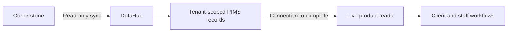

# V1 - Product direction

September 13, 2026. Assistant synthesis; original requests remain in [client requests](client-requests.v1.md), [project goals](project-goals.v1.md), [agentic startup](agentic-startup.v1.md), and [reference rules](reference-agent-rules.v1.md).

## Customer first

Follow [ADR 0001](adr/0001-new-features.v1.md): read the relevant clinic's [reviews](reviews.md), quote the exact problem with its source, and work backwards to a solution. Identify the five strongest customer pain points and discuss them before building, as the client requested. Preserve positive experiences too. The exports are available; a ranked analysis is not yet complete.

Build one hospital-configurable product for the whole client journey and clinic workflow. Integrate with Cornerstone first because it holds existing records; eventual replacement is the user's goal. Keep each hospital's branding and data separate.

## What exists and what is missing

Source inspection, not fresh production verification:

| Area | Existing foundation | Gap |
| --- | --- | --- |
| Workflow | One app, check-in, room/visit status, staff tasks, follow-up and analytics; see [architecture](architecture.md) | Proof that the whole workflow works with the clinic's live data |
| Ingestion | [DataHub receiver](../apps/internal/app/api/integrations/datahub/_datahubWebhook.ts) and [PIMS record storage](../packages/db/src/datahub.ts); historical sandbox traffic | Confirm activation, initial sync, mapping and freshness |
| Product reads | [Agent clinic loader](../apps/internal/app/api/agent/_clinicData.ts), [arrival](../packages/db/src/arrivalIntake.ts), [account claims](../packages/db/src/clientAccountClaims.ts), [portal](../packages/db/src/clientJourneyPortal.ts) | These inspected paths still read mock clinic tables; received PIMS records must feed product reads |
| Agents | Client/staff separation, typed tools, audit, memory, ADK and deterministic paths; see [agent architecture](agent-architecture.md) | Proven live outcomes; a specialist hierarchy is not an accepted requirement |
| Execution and memory | [ADK runtime](../packages/agents/src/adkRuntime.ts) runs ADK, then a deterministic workflow for stable results/effects; [memory](../packages/db/src/agentMemory.ts) uses vector and Postgres text ranking | Model execution does not establish autonomous outcome control; text ranking is not demonstrated BM25 |
| Communication and transactions | Message planning and delivery controls; booking/pricing demonstration paths | Proven pilot delivery/replies, production booking/payments, clinical interpretation and eventual PIMS replacement |

Keep the shared product, tenant boundaries, task ownership, visible visit status and integration interfaces. Reuse them when solving an evidenced customer problem.

## Integration timing

DataHub reports setup ready and asks for the go-ahead to enable read-only sync. Activation and successful production sync remain unconfirmed. Agreements and installation details belong in the [DataHub runbook](datahub.md#pilot-decisions-from-supplied-correspondence).

The user wants the connection running for about a week before inspecting real data and choosing the next build. Product implementation is deferred until then and the user's availability. Review analysis can proceed independently.

Proposed first proof: read a real appointment, match arrival, show the next step, complete staff handoffs and follow-up. During the read-only phase, staff perform PIMS changes. Do not imply that a Vet task update changed Cornerstone.

## OpenVet and Eight Sleep as references

The [original requests](client-requests.v1.md) include email replies, interpreting emailed results, and studying OpenVet and Eight Sleep. These are feature candidates to evaluate against customer problems.

- [OpenVet](https://www.openvet.ai/) describes veterinary clinical assistance using patient context and cited evidence. Its [email announcement](https://www.openvet.ai/resources/openvet-opens-to-every-licensed-veterinarian-free) describes clinical questions and forwarded blood tests. Useful reference: patient matching, sourced interpretation and veterinarian-reviewed results.
- [Eight Sleep support](https://help.eightsleep.com/en_us/what-are-you-business-hours-S1X5mlfr4) documents email alongside chat and phone. Useful reference: carry a request through to a verified outcome with context and human handoff. The source does not establish that all responses are automated.

These source checks were made September 13, 2026. Exact mailbox workflows, sending policy and clinical scope remain to be defined. No framework or additional vendor has been selected.

## Review collection

Start with the four supplied [JSONL exports](reviews.md), separated by clinic. Deduplicate before ranking themes and state coverage gaps.

Earlier free-method research: [Google Business Profile](https://developers.google.com/my-business/content/pricing) has no API usage charge, but [review pagination](https://developers.google.com/my-business/reference/rest/v4/accounts.locations.reviews/list) requires authorized account access. Yelp's [standard endpoint](https://docs.developer.yelp.com/docs/places-intro) supplies only limited excerpts. Unofficial collectors load listings, expand text, scroll/paginate and save review IDs. References checked: [Google browser scraper](https://github.com/gaspa93/googlemaps-scraper), [self-hosted Google scraper](https://github.com/gosom/google-maps-scraper), [Yelp actor](https://github.com/yin/apify-yelp). None was verified to provide complete free history for these clinics. Supplied exports remove the immediate need to build a collector.
